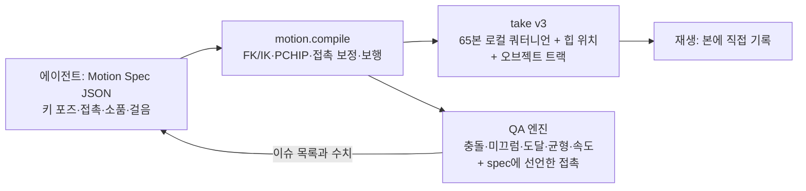

# CozyClay 3.0.0: ARDY/Kimodo 제거, 에이전트가 수학으로 모션을 계산

## Context

- 앞선 실험에서 결과가 좋았던 방식: 에이전트가 키 포즈를 수식(FK/IK)으로 직접 계산 → 모든 프레임을 굽기 → 작업 전용 QA → 몇 초 단위로 반복 수정. 하차, 걷기, 흡연 730프레임을 QA 0건으로 만들었다.
- CozyClay 2.x는 몸 동작을 Kimodo(ARDY)에 맡긴다. 제약(핀, 경로점)이 지켜지지 않는다(#772). 에이전트가 프레임별 좌표를 볼 수 없다. 메시지당 생성은 1회뿐이다. verify는 시트, 문, 손 소품 접촉을 측정하지 못한다.
- 목표: 2.x main과 분리된 저장소에서 CozyClay 3.0.0을 만든다. ARDY를 전부 들어내고, 브라우저 안의 결정적 "모션 컴파일러 + QA" 위에서 에이전트가 반복 작업하게 한다.

## 확정된 결정

- 리그: Mixamo X/Y-bot(65본, 손가락 포함)을 유지한다. **내부 모션 형식만 교체**한다(cskel27 npz → Mixamo 본을 직접 담는 새 take).
- ARDY는 **전부 제거**한다: Kimodo 생성, sidecar/bridge, npz 재생, 영상 모캡(GVHMR), ARDY 기반 physics/platform-fit/auto-physics. 2.x 프로젝트의 모션은 3.0에서 열리지 않는다(마이그레이션 없음, 릴리스 노트에 명시).
- 저장소: main과 겹치지 않는 **별도 비공개 저장소**를 쓴다(아래 P0). 작업은 내가 직접 한다(CLAUDE.md).

## 단계

### P0 저장소 분리
- GitHub에 비공개 저장소 `HaD0Yun/cozyclay3`를 만든다. 공개 저장소의 fork는 비공개로 만들 수 없어서 새 저장소에 미러링한다.
- `NomaDamas/CozyClay` origin/main `13e3a931`에서 미러링한다. 로컬 경로는 `~/CozyClay3`이다.
- `upstream`(NomaDamas) 원격은 fetch만 허용한다: `git remote set-url --push upstream DISABLED`.
- 버전을 `3.0.0-alpha.0`으로 올리고, `CLAUDE.md`에 v3 규칙(별도 저장소, upstream push 금지)을 적는다.
- 기존 `~/CozyClay`(커밋 안 된 변경 13개)와 main은 건드리지 않는다.

### P1 ARDY 제거
- 대상: `src/ardy/**`, `src/ardy-bridge-contract.js`, `src/i2v-motion-*`, `src/pose-extract/**`(영상 경로만), `src/domains/motion/motion-video-capture.js`, `tools/{kimodo,ardy,track,projflow,bench}`, `workers/api`의 kimodo 경로, `public/ardy/**`, mcp의 motion job 경로, 관련 테스트.
- `src/domains/motion.js`(2,730줄)에서 생성, regenerate, trail, platformFit, autoPhysics를 걷어낸다. take 설치, 버전, undo 골격은 남긴다.
- 액션 정리: `motion.generate*`, `generateFromVideo`, `setVideoDraft`, `platformFit.*`, `autoPhysics`를 삭제한다. `motion.clear`, `motion.loadVersion`, `motion.replace`는 v3 take용으로 남긴다.
- 재사용하려고 옮길 순수 수학: `src/ardy/ik.js`의 2본 해석 IK와 bend continuity, `fix-collisions.js`·`auto-physics.js`의 신체 세그먼트 표, `collision-blockers.js`의 씬 오브젝트 프록시. 지울 파일은 지우기 전에 끝까지 읽는다.
- 이 단계의 완료 기준: 빌드, lint, 테스트 통과. 포즈 모드와 IK 드래그는 계속 동작해야 한다.

### P2 take v3 형식과 재생
- `src/motion3/take.js`
  - `{schema:"cozyclay.take.v3", fps, frameCount, bones:[65 Mixamo 이름], rot: Float32Array(F×65×4), hips: Float32Array(F×3), objects:{id:{pos,rot,scale tracks}}, spec, specHash}`
- 저장: `motion-store.js`의 IndexedDB를 재사용하고 프로젝트 저장/불러오기에 포함한다.
- 재생: `applyTakeFrame(rig, take, f)`가 bone.quaternion과 hips 위치를 직접 기록한다. 기존 `playback.js`의 positional skinning을 대체한다.
- 기존 IK 키 레이어(`ik.js` 로컬 회전 delta)는 v3 take 위에서 그대로 동작하게 한다.

### P3 모션 컴파일러 `src/motion3/compiler/` (순수 JS, Node에서 테스트 가능)
- Python `scratchpad/exitcar/engine.py`와 `anim.py`를 회전 공간으로 포팅한다.
- 리그 측정값(본 길이, rest 프레임)은 X/Y-bot 바인드에서 한 번 추출한다.
- 내용:
  - FK와 채널 PCHIP(명시적 키만 사용, 단계 스텝 지원)
  - 루트 yaw/pitch, spine/head
  - 팔다리 2본 IK: 몸 기준 pole, FK↔IK 가중치 블렌드, pole 블렌드
  - 손목 twist/flex(해부학 범위 clamp)
  - 손가락 프리셋: relaxed, fist, grip(handle), pinch(cigarette), point
- 손 목표 앵커: world, body-local, bone 기준, object-local(문 손잡이처럼 움직이는 물체), face landmark(입)
- 반복 보정: 손가락이나 소품 끝점을 목표에 맞춘다. 블렌드 전환 중에는 몸통을 피해 호를 그린다.
- 보행 생성기: 발자국 계획, 체중 이동, 골반 bob/twist, toe-off, 팔 흔들기, 경로 곡선.
- 오브젝트 트랙: 경첩 회전 키(문), 본에 붙는 소품의 표시/숨김 스텝.
- 머리와 입 landmark는 X/Y-bot 메시에서 측정해 상수로 넣는다(Cascy 때와 같은 방식).

### P4 QA 엔진 `src/motion3/qa/`
- Python `qa.py` 검사를 전부 포팅한다.
  - 몸 캡슐과 씬 OBB 충돌(부위별 허용치), 바닥 관통
  - 디딘 발 미끄러짐, IK 미도달, 뼈 길이
  - 속도와 가속(코어와 손발 따로), 무릎·팔꿈치 꺾임과 과신전
  - 정적·동적 균형, 자기 충돌, 머리 타원체 관통, 몸통 관통
- **spec 선언형 검사**: `contacts:[{effector, target, tol, frames}]`, `orient:[...]`, `clearance:[...]`.
  - 손잡이, 입술, 불꽃처럼 작업마다 다른 접촉을 에이전트가 spec에 적으면 QA가 그대로 측정한다.
- 결과 형식: `{issues:[{kind, part, value, limit, frames}], metrics}`. 그룹으로 요약하고 프레임 범위를 붙인다.

### P5 에이전트 표면
- 새 액션
  - `motion.compile {characterId, spec, install?}` → take 설치와 QA 결과를 한 번에 반환한다. 비용이 싸므로 생성 횟수 제한을 없앤다.
  - `motion.sample {characterId, frames, joints}` → 월드 좌표를 반환한다.
  - `motion.qa {characterId, spec?}`
  - `object.setKeys {id, keys}` → 경첩 같은 오브젝트 키.
- 에이전트가 무엇을 받고 무엇을 할 수 있는지를 액션 설명에 적는다.
- `studio-prompt.mjs`를 다시 쓴다.
  - Kimodo, 생성 제한, 하차 패킷 문단을 삭제한다.
  - "키 포즈 → compile → QA 이슈 0까지 반복 → contact sheet 한 번 확인" 절차를 넣는다. 단위는 m, 좌표는 +Y up, yaw 0 = +Z다.
- `script` 도구(QuickJS)에서 compile, sample, qa를 반복 호출할 수 있게 한다.

### P6 수용 테스트
- CozyClay3 Studio 에이전트가 같은 장면을 만든다: 오픈카 → 문 열고 하차 → 걷기 → 흡연.
- 같은 QA 기준에서 이슈 0을 확인하고, contact sheet로 확인한다.
- 이 장면 spec을 회귀 fixture로 저장한다.

## 검증
- Node 단위 테스트(`test/verify-motion3-*.mjs`, `tools/run-tests.mjs`에 등록)
  - FK와 IK 정확도: 목표 오차 1mm 미만, 뼈 길이 불변
  - PCHIP 단조성
  - 보행에서 발 미끄러짐 0
  - QA가 일부러 넣은 위반(관통, 미끄럼, 미도달, 꺾임)을 모두 잡는지
- 브라우저: `tools/qa-browser.mjs`로 take v3 설치와 재생, 저장/불러오기 왕복, IK 드래그 동작을 확인한다.
- 단계마다 `npm run lint`와 `npm test`를 실제로 돌리고 결과를 보고한다. 단계별로 커밋하고, 새 저장소에 PR을 올려 merge한다.
- 최종: P6 장면을 에이전트가 처음부터 만들어 QA 0과 contact sheet를 보고한다.

## 위험
- `domains/motion.js`가 ARDY와 깊게 엮여 있어 P1이 가장 크다. 먼저 전부 읽고, 남길 골격을 표로 확정한 뒤 자른다.
- Mixamo 바인드 축이 본마다 달라서 회전 공간 IK가 까다롭다. 월드 공간 정렬 → 로컬 회전 변환을 한 함수로 모으고, Node 테스트로 고정한다.
- 접촉 판정이 근사(캡슐, 타원체)다. 메시 관통까지 보장하지는 않는다는 점을 문서에 명시한다.
